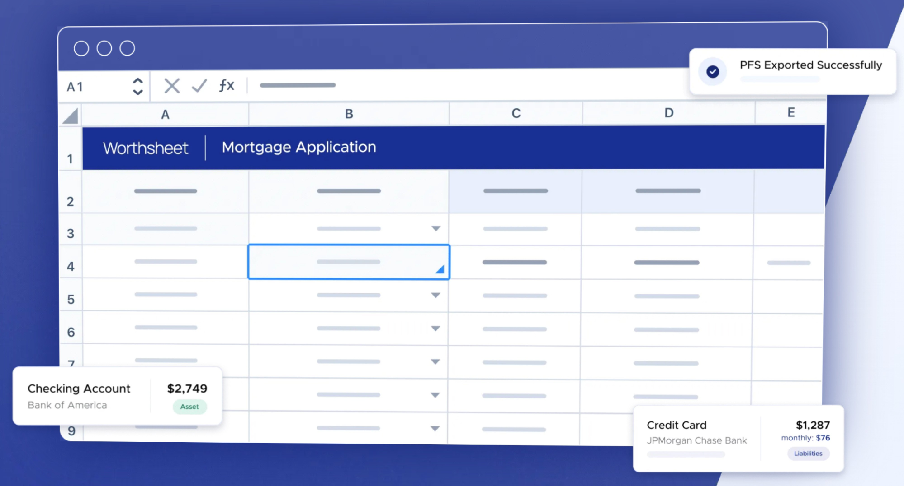
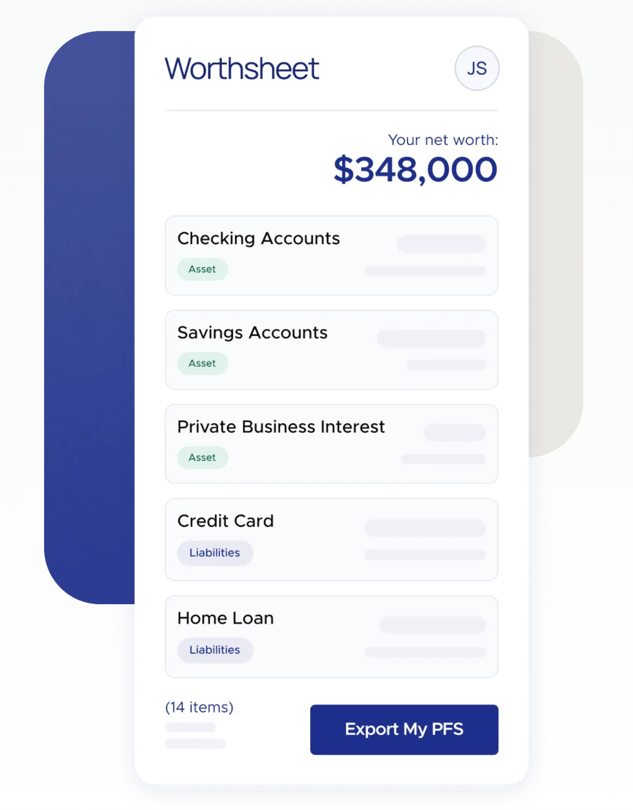

A personal financial statement (PFS) is a summary of a person’s financial health. A PFS provides an overview of an individual’s financial position at a specific point in time and includes information about an individual’s assets, liabilities, and net worth.

- **Assets:** These are items of value that an individual owns. One person can own assets, or multiple individuals (in the case of a married couple) can jointly own them. Additionally, one can own assets outright or purchase them using a loan. Assets that have outstanding loans should be noted and associated with a loan listed in the liabilities section of the personal financial statement. Examples of assets include:
  - **Checking and Savings Accounts**
  - **Retirement Accounts**: 401(k), 403(b), SEP IRA, Traditional IRA, Roth IRA, Pension
  - **Investment Accounts**: Brokerage Accounts, Mutual Fund Accounts, CDs, Money Market Accounts, Government Bonds, Crypto, Company Stock
  - **Real Estate**: Primary Home, Second Home, Investment Property
  - **Vehicles**: Car, Truck, Boat, RV
  - **Private Business Interest**: Ownership of a private business
  - **Other**: Health Savings Account (HSA), 529, Annuity, Life Insurance, Arts and Collectibles

- **Liabilities:** These are an individual’s debts or obligations. Debts should note whether they are associated with an individual, joint signers, or a private business. Examples of liabilities include:
  - **Credit Cards**
  - **Home Loans**: Mortgage, HELOC
  - **Student Loans**: Subsidized / Non-subsidized
  - **Vehicle Loans**: Auto, Boat, RV
  - **Notes Payable**: Personal loan, Business loan (personal guarantee), Other property loan
  - **Other Obligations**: Personal bankruptcy obligations, Alimony and/or child support

- **Net Worth:** This is calculated by subtracting total liabilities from total assets. Net worth represents the individual’s wealth or the difference between what they own and what they owe.

## When should I create a personal financial statement?

Personal financial statements are used for various purposes, such as assessing one’s financial health, planning for retirement, or as part of the overall financial planning process. It provides a snapshot of an individual’s financial situation, helping them make informed decisions about their finances. A PFS is not part of the standard mortgage application, because lenders collect your assets and liabilities on the Uniform Residential Loan Application (URLA, Form 1003). However, some lenders ask for one in special cases, such as for self-employed or business-owner borrowers, or portfolio or jumbo loans, and SBA business loans require one. See [do you need a personal financial statement for a mortgage](/do-you-need-a-personal-financial-statement-for-a-mortgage/) for details.

### What is the easiest way to create a personal financial statement?

Creating a personal financial statement doesn’t have to be a complicated process. Here are steps you can take to make it easier:

#### 1. Gather Financial Documents

Collect documents that detail your assets and liabilities. This may include bank statements, investment statements, loan statements, credit card statements, and any other relevant financial documents.

#### 2. Download the WorthSheet PFS Template:

[Get the free WorthSheet template](/download/). WorthSheet is a personal financial statement template that is available in Google Sheets or Microsoft Excel.

- **List Your Assets**: Create a list of all your assets. See the above list of assets and liabilities.
- **Determine Asset Values**: Assign values to your assets based on their current market or fair market value. For items like vehicles or personal property, you can estimate their value. You can also use websites such as [Zillow](https://www.zillow.com/), [Redfin](https://www.redfin.com/), [TrueCar](https://www.truecar.com/), and [Edmunds](https://www.edmunds.com/).
- **List Your Liabilities**: Create a list of all your liabilities. See the above list of assets and liabilities.
- **Calculate Net Worth**: Subtract your total liabilities from your total assets to calculate your net worth. The [WorthSheet template](/download/) will calculate this for you!

**[Download the free PFS template](/download/)**

#### 3. Update Regularly

Regularly update your personal financial statement to reflect changes in your financial situation, especially after significant events such as buying or selling assets, paying off loans, or changes in your income.

#### 4. Seek Professional Advice:

If you find the process challenging or have complex financial situations, consider seeking advice from a financial advisor or accountant. They can provide guidance and ensure accuracy.

### Why should I create a personal financial statement?

Remember, the goal is to create a clear and accurate snapshot of your financial situation. The easier you make this process for yourself, the more likely you are to keep your personal financial statement up to date. Before making a decision on a loan or savings plan, run the numbers! There are numerous online personal financial calculators such as a simple mortgage calculator, retirement contribution (403b calculator, 401(k) calculator), and full bank rate calculators. Try our [mortgage calculator with an amortization schedule](/mortgage-calculator/).
